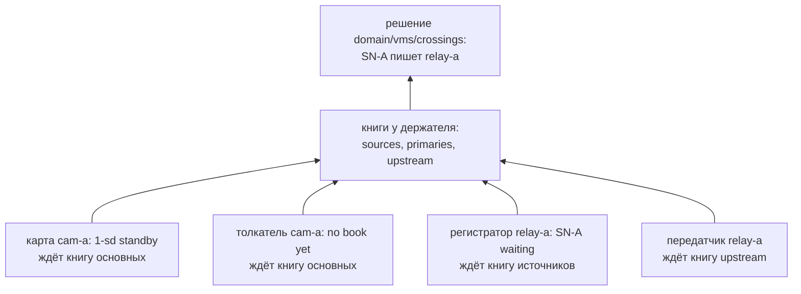

# Часть 5. Офис готов писать

> [!note] Записки поверх репозитория, а не его документация
> Это разбор: я читал код и восстанавливал по нему, как всё устроено, максимально простыми словами.
> **Источник истины — код.** Где записки расходятся с кодом, прав код.
> Проект описывает себя сам: [`README.md`](../../README.md) и указатели модулей.
> Состояние: коммит `2cfce43c`, 11 октября 2026.

[← карта разбора](README.md) · назад: [04-a-camera-boots.md](04-a-camera-boots.md) · вперёд: 06-who-records-the-camera.md (пишется)


Камера загружена и видна домену, но писать её некому: в офисе нет ни тома, ни регистратора. Эта часть — их появление. Анна на консоли офиса объявляет том и запись камеры `SN-A` по её имени в домене, `ref:SN-A`. Стартует регистратор офиса, и в нём живут приёмник, в который камера будет толкать поток, и передатчик, который понесёт поток в центр. Регистратор берёт запись — и ставит её ждать: книга источников ещё не назвала ему эту камеру.

Запросы части — сцена 6: [`traces/06-office-ready.txt`](traces/06-office-ready.txt), короткая — [`06-office-ready.brief.txt`](traces/06-office-ready.brief.txt). Ссылки — как в частях 3 и 4: «06:195» — строка полной трассы, «06b:70» — короткой. Часы стоят на `1757500225.0`.

## 5.1. Консоль офиса проверяет Анну сама

Анна входит на консоль домена и получает токен человека (06b:4-14). С этим токеном она идёт на консоль **офиса** (06b:16-54):

```
# anna → relay-a:8080
POST /rec/volumes
  Idempotency-Key: relay-a-disk
  Authorization: Bearer «токен 1: person sub=anna на 900 с»
{"name": "disk", "kind": "local", "url": "file:///data/relay-a/relay-a/archive/volume", "quota_bytes": 1073741824, "server": "relay-a"}
→ …

# console on relay-a → /run/configstore/console.sock
POST /v1/write {"op": "put", "key": "rec/volumes/disk", "cas": "", "items": {
  "name": "disk", "kind": "local", "url": "file:///data/relay-a/relay-a/archive/volume", "server": "relay-a",
  "quota_bytes": "1073741824", "enabled": "true", "shrink_confirmed": "0", "admits": "true"
}}
→ 200 {"index": 2011}

# anna ← relay-a:8080: ответ на POST /rec/volumes
→ 201 {"row": {…}}
```

Между запросом Анны и записью тома консоль офиса читает только своё хранилище (06:78-123):

```
# чем проверить подпись токена и не отозван ли он
GET /v1/get?key=domain/keys       → набор rev 1, index 2004   ×4
GET /v1/get?key=domain/revoked    → null                      ×2
# что Анне можно на этом кластере
GET /v1/get?key=domain/grants     → {"anna|admin|": "1757586520.0"}, index 2005
```

В домен она не ходит. Строки с `index` 2004 и 2005 — те, что агент `relay-a` записал в сцене 3 ([3.10](03-members-join.md)). Подпись токена она проверяет набором ключей, который агент `relay-a` принёс домой в сцене 3. Право `admin` Анны на этом кластере — строка, которую агент принёс тогда же, со сроком до `1757586520` (`ClusterTrust`, `w2cplatform/domain/agent.py:573-613`; раздел [3.8](03-members-join.md)).

Так права работают и при выключенном домене. Цена — срок: агент, который не дотянулся до домена, права не продлит, и через сутки консоль офиса Анну не пустит. Что это значит, когда центр лежит долго, — часть 10.

Том `disk` — обычный том сервера: `kind: local`, гигабайт, на сервере `relay-a`. В отличие от карты камеры ([4.6](04-a-camera-boots.md)), это архив с движком.

## 5.2. Регистратор офиса: приёмник и передатчик внутри

Стартует регистратор `r-relay-a-1` (06b:56-67; 06:164-196). Первым делом он берёт слот:

```
# recworker r-relay-a-1 on relay-a → /run/configstore/recworker.sock
POST /v1/write {"op": "put", "key": "rec/slots/r-relay-a-1", "cas": "", "items": {
  "holder": "relay-a:2101:000835", "until": "1757500270.0", "released": "false", "gen": "1", "server": "relay-a"
}}
→ 200 {"index": 2012}

# recworker r-relay-a-1 on relay-a → /run/configstore/recworker.sock
GET /v1/get?key=domain/vms/upstream
→ 200 {"items": null, "index": ""}
```

Второй запрос — уже не регистратора, а его **передатчика**. В регистраторе живут две вещи, которых нет у регистратора серверного кластера М11 (`RecWorker.host_ingest`, `vms/recworker.py:1349-1375`; ADR-0065, дополнение 2026-10-08):

| | Что это | Зачем |
|---|---|---|
| приёмник (`Ingest`) | дверь, в которую камеры толкают свои потоки; адрес `http://relay-a:8091/ingest` | до камеры за офисом не дозвониться, поэтому поток несёт сама камера; приёмник раздаёт его тем, кто в кластере его хочет: регистратору — писать, шлюзу — показывать |
| передатчик (`Forwarder`) | клиент приёмника уровнем выше, в центре | центр не звонит вниз никогда; когда центр хочет камеру, офис сам несёт её поток вверх |

Приёмник проверяет токен потока набором ключей, который принёс агент **его** кластера (`keys=lambda: ClusterTrust(self.vars).keyset()`, `recworker.py:1362`). Общего секрета у камеры и офиса нет. Действия регистратора приёмник оборачивает: запись камеры, которая толкает, пишется из приёмника, а не из конвейера (`IngestRecordings`, `recworker.py:1368-1371`; `vms/ingestrec.py:1-27`).

Передатчик при создании читает книгу `upstream`: куда нести каждую камеру вверх и с каким токеном (`chain.Forwarder`, `vms/domainpart/chain.py:183-223`). Книги нет — решения «кто пишет камеру» ещё не было. Читать её регистратору разрешает его роль: спека записи объявляет четыре книги, которые читает воркер записи, — `primaries`, `sources`, `upstream`, `asks` (`vms/rec.subsystem.yaml:52-56`). В первом прогоне роли регистратора было дано только `primaries`, и на `configstore` передатчик не поднимался вовсе (находка F3, исправлена 50c1122c).

> [!important] Чего в курсе нет
> Процесс регистратора курса (`vms/__main__.py`) приёмник не поднимает. На стенде регистратор с приёмником и передатчиком собирает сценарий, так же, как тесты (`stand.py:686-707`; М12B, [`module-design.md`](../../М12B_DomainVMS/module-design.md), «Что открыто», пункт 5). Провода у приёмника тоже нет: SRT и долгого опроса по HTTP в курсе нет, и вызовы приёмника в трассах печатаются маршрутами продукта (`vmssubsystem/vmsworker/recproc/ingest.go`). В этой сцене таких вызовов ещё нет: камера опрашивать приёмник не начала.

## 5.3. Запись камеры другого кластера — по `ref:`

Анна объявляет запись (06b:69-135):

```
# anna → relay-a:8080
POST /rec/recordings {"name": "SN-A", "cam": "ref:SN-A"}
  Idempotency-Key: relay-a-SN-A
  Authorization: Bearer «токен 1: person sub=anna на 900 с»
→ …

# console on relay-a → /run/configstore/console.sock
POST /v1/write {"op": "put", "key": "rec/idem/relay-a-SN-A", "cas": "", "items": {
  "state": "pending", "at": "1757500225.0", "sub": "anna", "digest": "«ключ 3»"
}}
→ 200 {"index": 2013}

# console on relay-a → /run/configstore/console.sock
POST /v1/write {"op": "put", "key": "rec/idem/relay-a-SN-A", "cas": 2013, "items": {…, "id": "SN-A"}}
→ 200 {"index": 2014}

# console on relay-a → /run/configstore/console.sock
POST /v1/write {"op": "put", "key": "rec/recordings/SN-A", "cas": "", "items": {
  "id": "SN-A", "revision": "1", "name": "SN-A", "cam": "ref:SN-A", "retention_days": "30", "enabled": "true",
  "labels": "", "home": "", "until": "0.0", "min_depth_days": "0.0", "when": "always"
}}
→ 200 {"index": 2015}

# console on relay-a → /run/configstore/console.sock
POST /v1/write {"op": "put", "key": "rec/idem/relay-a-SN-A", "cas": 2014, "items": {"state": "done", "status": "201", "body": "{…}", …}}
→ 200 {"index": 2016}
```

Четыре записи на одну запись камеры. Три из них — строка повтора `rec/idem/relay-a-SN-A`: сначала «начато», потом «под каким `id`», потом «сделано, вот ответ». Если Анна пошлёт тот же запрос с тем же ключом ещё раз, консоль отдаст сохранённый ответ, а не создаст вторую запись. `digest` — sha256 тела запроса, в котором замаскирован каждый секрет и каждый адрес; трасса печатает его меткой `«ключ 3»`. Тот же ключ с другим телом консоль за повтор не примет (`IdempotencyKeys._tag`, `w2cplatform/console.py:1334-1360`). Это правило консоли М11, и здесь оно без изменений («Три камеры», раздел [8.1](../three-cameras/08-failures.md)).

Главное в строке записи — `cam: "ref:SN-A"`. Своих камер в кластере `relay-a` нет. `ref:` значит «камера другого кластера, по имени домена». Где она и как до неё дотянуться, офис сам не знает и не узнает: камера за NAT, и её адрес `rtsp://cam-a.local/live` отсюда не достать ([4.8](04-a-camera-boots.md)). Ответ ему даст домен — книгой источников. Остальные поля — умолчания спеки записи: `when: always` (основная запись, а не резервная), `home: ""` (любой том), 30 дней.

## 5.4. Регистратор берёт запись

Дальше — то же, что в серверном кластере М11, и ничего доменного (06b:137-204):

| Запись | `index` | Кто | Что |
|---|---|---|---|
| `rec/slots/r-relay-a-1` | 2017 | регистратор | слот продлён проходом аренды |
| `rec/holds/disk` | 2018, 2019, 2021 | регистратор | удержание тома `disk`: взято и продлено |
| `objects/rec/used/disk` | 2020 | регистратор | отметка «этот том открыли воркеры записи, и где» (`w2cplatform/contract.py:120`) |
| `rec/placement/SN-A` | 2022 | контроллер записей | «most free capacity (50) among 1 worker(s); on relay-a, whose resource is live» |
| `rec/workers/r-relay-a-1` | 2023 | контроллер записей | назначение: `SN-A` |
| `rec/epoch/SN-A` | 2024 | регистратор | эпоха записи 1 |

Сравните причину размещения с камерой: там «whose resource is unknown», здесь «whose resource is live» ([4.6](04-a-camera-boots.md)). У офиса есть ресурс сервера и его дверь `platform/doors/relay-a` (2001), а у камеры нет.

## 5.5. Heartbeat регистратора

Регистратор говорит о себе в heartbeat'е — объекте `rec/heartbeats/r-relay-a-1` на своём сервере. Сценарий печатает из него нужные поля (06b:206-221; `stand.say_heartbeat`, `stand.py:720-733`):

```
## heartbeat r-relay-a-1 (rec/heartbeats/r-relay-a-1, объект на relay-a):
## {
##  "ingest": "http://relay-a:8091/ingest",
##  "ingest_streams": {},
##  "volume": "disk",
##  "status": [
##   {
##    "id": "SN-A",
##    "cam": "ref:SN-A",
##    "phase": "waiting",
##    "why": "SN-A is not in this cluster's source book: the domain has not asked this cluster to record it, or has never seen it publish a door",
##    "source": null,
##    "via": null
##   }
##  ]
## }
```

Поля о приёмнике — слова продукта (`ingest_fields`, `recworker.py:1376-1390`, зовёт heartbeat — `:1325`; у продукта `Ingest.Stats`, `recproc/ingest.go`):

| Поле | Что это | Сейчас |
|---|---|---|
| `ingest` | где регистратор берёт потоки, которые толкают камеры | `http://relay-a:8091/ingest` |
| `ingest_streams` | по каждой камере — что приёмник с ней сделал: опросы, кадры, отдачи | `{}`: ни одна камера ещё не опрашивала |
| `upstream` | по каждой камере книги `upstream` — что передатчик донёс и что потерял | нет поля: книги нет (`**({"upstream": up} if up else {})`) |
| `forwarder_errors` | круги передатчика, которые упали | нет поля: падений не было |

Адрес приёмника живёт **в heartbeat'е**, а не отдельной строкой. Домен heartbeat'ы регистраторов уже читает — из отчёта офиса — и адреса приёмников берёт там же, когда пишет книги (`ingest.py:1-15`; ADR-0065). Отдельного объекта `rec/ingest` больше нет (ADR-0003, `recworker.py:1327-1332`).

## 5.6. Почему запись ждёт

`phase: waiting`, и `why` говорит почему. Регистратор ищет источник записи на каждом проходе (`RecWorker.source`, `recworker.py:597-604`). Для обычной камеры он ищет её в heartbeat'ах VMS своего кластера. Для `ref:` — в своей копии **книги источников** `domain/vms/sources` (`crossing.resolve_in`, `vms/domainpart/crossing.py:541-563`):

```python
    if not items or ref not in items:
        raise NotResolvable(f"{ref} is not in this cluster's source book: the domain has not asked this cluster "
                            f"to record it, or has never seen it publish a door")
```

Книги нет (06:752-758, дважды за проход), и запись не разрешается. Это не ошибка регистратора и не ошибка Анны. Решение, какой кластер пишет камеру, одно на весь домен и лежит у держателя ([00](00-overview.md), «Что из этого следует»). Строка записи в офисе — желание офиса. Книга источников — ответ домена: «да, пиши, и вот где камера».

Когда ответ придёт, в книге будет запись вида `{"cluster": "cam-a", "live_url": "ingest://relay-a/SN-A", "push": true, …}` (справочник [01](01-reference.md), «Книги и решения VMS»). `ingest://relay-a/SN-A` — не адрес, по которому звонить. Это слово «камера толкает в приёмник этого кластера»: строить конвейер не нужно, запись подпишется на свой приёмник и будет писать то, что придёт (`vms/ingestrec.py:1-12`, `ingest_ref`).

Почему `waiting`, а не `running` с пустым конвейером. Фаза записи — не только слово для оператора. По ней воркер VMS на домене пишет в книгу основных, пишется ли камера, а карта камеры по этой книге решает, подменять ли основную ([4.7](04-a-camera-boots.md)). «Running» без единого кадра сказал бы карте «тебя пишут», и карта не писала бы ничего (`recworker.py:847-852`; `ingestrec.py:16-19`, «nothing yet»). Поэтому запись камеры, которая толкает, `running` только с кадрами.

Ждать придётся трёх вещей. Части 6 и 7 разбирают каждую:

| Шаг | Кто | Что | Часть |
|---|---|---|---|
| решение | воркер VMS на домене | «`SN-A` пишет `relay-a`» — строка `domain/vms/crossings` | 6 |
| книги | воркер VMS на домене | источников — офису (`ingest://relay-a/SN-A`), основных — камере (куда толкать и токен потока), `upstream` — офису | 6 |
| доставка | агенты | офис несёт свои книги и книги камеры; камера берёт свои через офис | 6 |
| желание | регистратор офиса | находит `SN-A` в книге и подписывается на свой приёмник — это и значит «хочу поток» | 7 |
| поток | камера | опрашивает приёмник, слышит «толкай» и толкает кадры из кольца | 7 |

## 5.7. Что приёмник проверит, когда камера придёт

Приёмник готов, но пуст. Когда у камеры будет книга основных, её толкатель придёт сюда с долгим опросом. Что приёмник у него спросит, видно по коду уже сейчас (`Ingest._check`, `vms/domainpart/ingest.py:575-592`):

| Проверка | Отказ | Почему |
|---|---|---|
| у кластера есть набор ключей | «no key set yet — is this cluster's agent running?» | токен проверяется ключами, которые принёс агент **этого** кластера; нет агента — нет ключей |
| токен — вида `stream`, подпись сходится, не истёк, не отозван | «stream token refused: …» | выпускает его только подписывающий, по просьбе воркера VMS на домене (справочник [01](01-reference.md), «Токены») |
| `aud` — `ingest:relay-a`, `ref` — та камера, о которой запрос | «stream token is for … at …, not … at …» | токен на приёмник одного кластера и одну камеру не откроет ни чужой приёмник, ни чужую камеру (`audience`, `ingest.py:324-325`) |

Каждый запрос камеры несёт её часы (`camera_now`; у продукта заголовок `X-Camera-Clock`). Приёмник запоминает разницу между ними и своими часами и по ней переводит время кадров на часы кластера (`ingest.py:585-591`). Кадр несёт время, когда его **сняли**, по часам камеры: у MPEG-TS поверх SRT своего настенного времени нет (`ingest.py:36-44`).

Ответ на опрос приёмник даст только камере, которую толкают **сюда**: она должна быть в книге источников этого кластера с дорогой «толкает» (`should_from_snapshot`, `ingest.py:2636-2660`). Иначе он промолчит о ней. Камера, которую регистратор забирает сам по RTSP, тоже держит опрос, и сказать ей «тебя не пишут» значило бы заставить карту писать всё время (`ingest.py:2639-2645`).

Почему приёмник — в регистраторе, а не отдельным процессом. Поток хочет тот, кто его потребляет: регистратор — писать, шлюз — показывать. У продукта приёмник живёт там же (`recproc/run.go`), и раздача, которая раньше была на воркере камеры, переехала с камеры в кластер, который поток потребляет (`ingest.py:9-15`). Приёмников у кластера может быть несколько, по одному на регистратор. Тогда они передают потоки друг другу: желание у любого — желание у всех (`heartbeat_peers`, `ingest.py:64-68`).

## 5.8. `rec/polled`: свидетель, что камера жива

Вместе с каждым heartbeat'ом регистратор пишет ещё один объект — от имени приёмника (`ingest_fields` → `Ingest.publish_polled`, `recworker.py:1380`; `ingest.py:470-492`):

```
rec/polled/http___relay-a_8091_ingest
{"cluster": "relay-a", "ingest": "http://relay-a:8091/ingest", "ts": 1757500225.0, "units": {}}
```

Это **когда каждый член последний раз опрашивал этот приёмник**, в виде возрастов. Имя объекта — адрес приёмника, где всё, кроме букв, цифр, `.`, `_` и `-`, заменено на `_`. Объект — один на приёмник, а не на кластер: приёмников у кластера может быть несколько, и каждый знает только тех, кто опрашивает его (`ingest.py:475-478`). В трассе сцены 6 его нет: свои объекты регистратора трасса не пишет. Сценарий напечатает его в сцене 9, когда в `units` появится `cam-a` (часть 7).

Зачем он, если у камеры есть агент и отчёт. Опрос держит **толкатель** камеры, а отчёт пишет **агент** — это разные процессы (`ingest.py:470-473`). Агент камеры может замолчать: упал, завис, не может дотянуться до офиса. Толкатель при этом опрашивает приёмник раз в секунду. Тогда объект `rec/polled` — свидетель домена, что камера жива, хотя её отчёт стареет. Спека записи так и объявляет его: отчёт `polled/` и свидетель по полю `cam` (`vms/rec.subsystem.yaml:368-376`).

Три решения в этом объекте, и у каждого причина.

**Возрасты, а не времена.** Домен сравнивает их с `ts` самого объекта, и разница часов офиса и держателя сокращается.

**По члену, а не по камере.** Ключ в `units` — `sub` токена потока, то есть член, которому выдана книга: `cam-a`, а не `SN-A`. Домен ищет молчащего члена по его имени в домене (ADR-0010), и свидетель должен называть его тем же именем.

**Наверх — с отчётом офиса.** Спека объявила `polled/` объектом отчёта, поэтому агент офиса понесёт его наверх с ближайшим отчётом, как heartbeat'ы (`uplink.objects`, `uplink.py:51-55`). Домен читает его, когда решает, жив ли член, для тревог (`DomainAlarms.alive_at`, `w2cplatform/domain/alarms.py:239`). Его же он показывает на `/metrics` консоли домена: потерянные кадры и шаги часов камер (`stream_metrics`, `ingest.py:1771-1800`).

## 5.9. Передатчик ждёт книгу

Передатчик офиса построен, но ему нечего делать. Его работа — держать опрос у приёмника **центра** за каждую камеру книги `upstream` и нести поток вверх, когда центр его хочет (`chain.py:183-223`; М12B, [урок 4](../../М12B_DomainVMS/04-a-chain-site-relay-centre.md), шаг 2). Книга пуста, опросов нет.

Он уже слушает свой приёмник: приёмник будит его, когда что-то меняется (`local.listen(self.woken.set)`, `chain.py:217`). Под именем `up:relay-a` передатчик будет подписчиком приёмника, как регистратор или шлюз (`chain.py:197`). Звонит он только вверх. В курсе это вызов функции `dial` — сеть стенда (`stand.py:690-703`); у продукта — тот же опрос и толчок по HTTP. Как это работает, когда Борис откроет камеру в центре, — часть 8.

## 5.10. Второй офис и центр

`relay-b` делает то же для `SN-B`: том `disk`, регистратор `r-relay-b-1` с приёмником и передатчиком, запись `ref:SN-B`. Его запросы в трассе приглушены (`scenes.py:183-196`).

В центре стартует свой регистратор `r-srv-1` с приёмником `http://srv:8091/ingest` и один раз говорит heartbeat. Записей у центра нет. Приёмник центра нужен для другого: в него офисы понесут потоки, когда их захочет зритель (часть 8). Передатчика у центра нет смысла поднимать: выше центра никого нет. Но регистратор курса строит его всегда (`recworker.py:1372-1373`), просто его книга `upstream` у центра будет пустой.

## 5.11. Кто чего ждёт

Вся установка теперь стоит и ждёт одного решения. Стрелка — «ждёт»:



Каждый, кто ждёт, ждёт **строку в своём хранилище**, а не звонок. Книги придут домой с проходом агента: к офису — от двери домена, к камере — от двери офиса. Никто никого не будит. Поэтому от решения до первого кадра пройдёт несколько проходов: воркер VMS на домене раз в 5 с, агенты раз в 30 с, опрос толкателя — около секунды ([00](00-overview.md), «Жизнь камеры сверху вниз»).

## Состояние после сцены 6

**Хранилище `relay-a`** — новое за сцену:

| Ключ | `index` | Кто писал | Что |
|---|---|---|---|
| `rec/volumes/disk` | 2011 | консоль офиса | том, 1 ГиБ |
| `rec/slots/r-relay-a-1` | 2017 | регистратор | слот |
| `rec/idem/relay-a-SN-A` | 2016 | консоль офиса | строка повтора: сделано, ответ 201 |
| `rec/recordings/SN-A` | 2015 | консоль офиса | запись `ref:SN-A`, `when: always` |
| `rec/holds/disk` | 2021 | регистратор | удержание тома |
| `objects/rec/used/disk` | 2020 | регистратор | том открыт |
| `rec/placement/SN-A` | 2022 | контроллер записей | запись — на `r-relay-a-1` |
| `rec/workers/r-relay-a-1` | 2023 | контроллер записей | назначение |
| `rec/epoch/SN-A` | 2024 | регистратор | эпоха 1 |

**Объекты `relay-a`:** heartbeat `rec/heartbeats/r-relay-a-1` с `ingest`; свидетель `rec/polled/http___relay-a_8091_ingest` с пустыми `units`.

**У `relay-b` и `srv`** — то же, приглушено.

**Не существуют:** решения «кто пишет `SN-A`» и ни одной книги, кроме учёток RTSP. Регистратор офиса ждёт книгу источников, передатчик — книгу `upstream`, толкатель камеры — книгу основных, а карта камеры держит, потому что основной записи не знает никто. Всё это разрешится одним решением у держателя — с него начинается часть 6.

---

[← карта разбора](README.md) · назад: [04-a-camera-boots.md](04-a-camera-boots.md) · вперёд: 06-who-records-the-camera.md (пишется)
