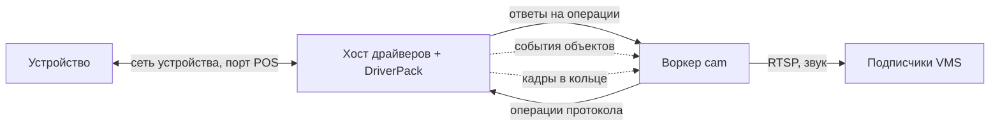
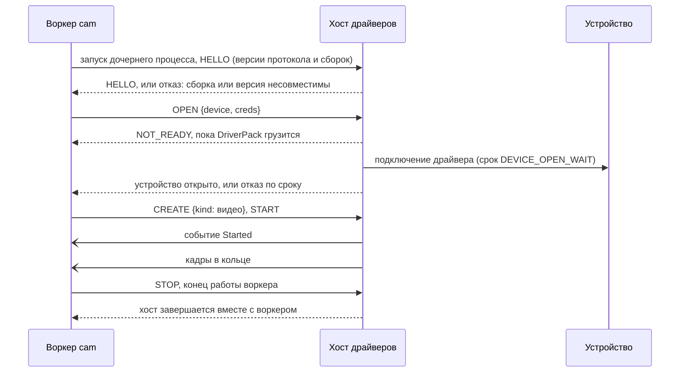

# ADR-VMS-0005. Хост драйверов DriverPack в уроке V/01: свой тонкий хост дочерним процессом воркера, протокол — норма урока

## Context and Problem Statement

Класс системы: система сбора с устройств (подсистема камер `cam`, урок V/01).

- **DriverPack** — пакет драйверов IP-камер другой команды: C++, около 262 драйверов, модели описаны в `.rep` по `DeviceInfo/DeviceInfo.xsd`. Менять его мы не можем, просить изменения — можем.
- **ipintd** — хост драйверов. Продукт `vmssubsystem` сделал его 2026-10-01, чтобы падение драйвера не роняло воркер (`vmssubsystem/docs/2026-09-30-driver-host-process.md`). Теперь его ведёт команда DriverPack в своём дереве: код взят из `vmssubsystem` на коммите `ea1be7d0b23108db3c53b3d0c90dff99ab60dc13` от 2026-10-14 — срезе остановленного продукта (README хоста в дереве DriverPack, `ipintd/README.RU.md:12`). Снимок дерева DriverPack с хостом, `master@100c7f6deb2`, положен владельцем 2026-11-12 в `/Users/murat/w2c/ipintd/ipint.driverspack_git-master@100c7f6deb2/` (без Git; далее — **DP**). У хоста там системная служба, пакеты deb, rpm и MSI (`DP/ipintd/dist/`) и протокол версии 1 из 11 операций (`DP/ipintd/docs/protocol.md`, `DP/ipintd/src/protocol.h:13-27`). Протокол v1 умеет видео, `preset`, серийный номер, карту устройства и `RESOLVE`; на `output` хост отвечает `UNSUPPORTED` (`DP/ipintd/src/server.cpp:779`).
- **Урок V/01 написан так, будто `camworker` сам вызывает C++ API DriverPack:** `CreateTextEventSource`, `Started` (`VMS/01-cam/spec/01.2-cam.norms.md:104,113`); `SetRelayStatus`, `CreateUnit`, `CreateVideoAnalytics`, `MoveContinuous`, `Call` (`01.4:43,294,312,330,253`); `StartSearch`, `Autodetect` (`01.8:95-98`); покрытие, индекс и чтение архива устройства (`01.5:30-43,65-73,153-176,188-194`). Драйвер POS слушает порт, касса подключается к нему сама (`01.2:102-114`, ADR-0102 доп. (9) п. 2).
- **Решения курса противоречат друг другу:** ipintd — «не норма» (`decisions/0090-…:201`); «ipintd делает курс» (`decisions/0083-…:1599-1601`); в ADR-0102 доп. (9) п. 8 вопрос «кто делает» открыт. С 2026-11-06 курс от продукта отключён (ADR-0083 доп. (115)).

Вопрос: как урок V/01 работает с DriverPack — кто держит драйверы, где граница процесса и что нормирует урок.

## Decision Drivers

* Закрытые SDK вендоров не работают рядом с ключами и учётными данными воркера (`ОБРАТНАЯ-СВЯЗЬ-ИЗ-ПРОДУКТА.md:5776-5790`).
* Падение драйвера не роняет воркер и камеры других воркеров.
* Урок генерируется по спецификации: то, с чем работает воркер, должно быть нормой урока, а не чужим договором без правила совместимости (у ipintd оно «not yet agreed», `DP/ipintd/docs/protocol.md:151-153`).
* Воркер остаётся на Go и Python — языках линий генерации; C++ — только там, где без него нельзя (граница DriverPack, тулсет MSVC v141 на Windows, `DP/ipintd/README.RU.md:67-70`).
* Меньше механики владения: без сессий между процессами, «подхвата» камер и отдельной эпохи.

## Considered Options

* **А. Свой тонкий хост по норме урока, дочерний процесс воркера, протокол — норма урока.**
* **Б. ipintd поставщика как есть, системной службой, с просьбами к команде DriverPack.**
* **В. Одна служба-хост на сервер (как сейчас у ipintd), но свой протокол.**
* **Г. Весь урок на C++, DriverPack в процессе воркера.**

## Decision Outcome

Выбран вариант **«А»**. Слово владельца 2026-11-12 «принимаю все 5» — на пять вопросов предложения с советами представителя.

1. **Граница.** `cam` работает с DriverPack только через хост драйверов, по протоколу. C++ API DriverPack в процессе воркера не вызывается.
2. **Хост пишем сами, тонким** (вопрос 1). Хост генерируется на C++ по норме урока. В хосте: загрузка DriverPack, выбор модели по `.rep`, одно подключение на устройство, полосы вызовов со сроком, учёт зависших вызовов, кадры в кольцо, события драйвера как есть. В воркере — всё, что уже нормирует урок: хозяин блока, `children`, `can`, лицензия, правила, повторы, события в ведра. Протокол хоста отдаётся команде DriverPack: если их ipintd его реализует, он становится запасным путём без переделки урока.
3. **Хост — дочерний процесс воркера, одна копия на воркер** (вопрос 2). Запуск при старте воркера, загрузка DriverPack параллельно со взятием слота. Канал хост — воркер только у этой пары процессов: другого клиента нет, адреса для подключения извне нет. Норма называет свойства, средства по ОС выбирает реализация (например, `socketpair` и `PR_SET_PDEATHSIG` на Linux, job object на Windows):
   - **срок жизни** — хост не переживает воркер; сессия равна слоту, эпоха одна, «подхват» камер, окно 15 с и `HELD_ELSEWHERE` не нужны;
   - **изоляция** — хост не читает ключей и учётных данных воркера и не может его отладить (средства — например, `no_new_privs`, Landlock, seccomp, `PR_SET_DUMPABLE=0` у воркера на Linux; ограниченный токен или AppContainer на Windows);
   - **память** — потребление хоста ограничено и учитывается в бюджете воркера `B + n·I` вместе с самим воркером; при выходе за предел у хоста — отказ его камер, воркер жив (средство — например, cgroup хоста внутри юнита воркера; если для этого нужна делегация в юните платформы — сначала запрос платформе по ADR-VMS-0001, -0002);
   - **падение хоста** — ошибка работы его камер: `dead`, перезапуск с паузой по P/03.3.

   Второй хост у воркера — только для драйверов из нового ключа `DRIVER_GROUPS` (вводится нормой, шаг 4 плана); хост базового воркера (поиск, V/01.8) стартует при первом поиске.
4. **Протокол — норма урока** (новая глава V/01.9 или отдельный урок «хост драйверов»). Операции: `HELLO`, `CATALOG`, `DESCRIBE {model | device}`, `OPEN {device, creds}`, `CREATE {handle, kind, index | template}`, `START`, `STOP`, `CALL {handle, method, args, deadline}`, `SEARCH`, `AUTODETECT`. События привязаны к объекту, состояния `Started`, `SignalLost`, `Failed`. `kind` — фабрики `IDevice`: видео, звук в обе стороны, входы-выходы, телеметрия (своей полосой, V/01.4 N1.4d), единица, аналитика, текст. **Архив устройства (V/01.5)** — обязательная часть протокола: покрытие, индекс участков, чтение интервала, конец и отказ чтения, передача байтов, сроки и освобождение сессий чтения; бюджеты, резерв и `reads_stuck` V/01.5 сохраняются. Версия согласуется в `HELLO`, правило — только добавлять. Норма называет операции, исходы и сроки, а не устройство хоста.
5. **Кадры и сеть** (вопрос 3). Хост передаёт кадры воркеру в кольце разделяемой памяти (дескриптор — по каналу п. 3). **Формат кольца хост → воркер — норма V/01.9**: размеры, метки времени и кодек, порядок публикации, переполнение и повреждение, прекращение чтения. Доля и именование публичных файлов `cam.shm` остаются по V/01.2 N1.3 (`01.2:153-159`); там формат файла решает реализация (`01.2:160-161`), и Implementation decides п. 4 (`01.2:379-380`) уточняется ссылкой на V/01.9, если один формат используется для обоих. **У хоста нет собственного сетевого API для клиентов VMS:** RTSP-сервера, HTTP-двери, GStreamer. RTSP и звуковые точки раздаёт держатель — урок их уже нормирует; условие: кадры читает воркер, `unit_mb` замеряется заново до норм бюджета. **Сетевой обмен драйверов с устройствами, поиск и слушающие порты, предусмотренные описанием устройства (POS, V/01.2 N1.2b), разрешены** в пределах, которые задаёт держатель: проверка занятого порта и допуск слушающего адреса V/01.2 сохраняются.
6. **Запасного хоста нет** (вопрос 4). Сначала кэш индекса репозиториев (просьба 1 к команде DriverPack) и замер времени перезапуска хоста. Запасной хост с загруженным DriverPack стоит порядка сотни МБ на воркер (замер продукта на macOS — около 160 МБ, `ipint.driverspack_git/2026-10-02-note-for-driverpack-team.md:30-31`); решение о нём — только по замеру частоты падений и времени перезапуска (шаг 8 плана).
7. **Сборка C++** (вопрос 5). Сначала только Linux. Генерация и сборка — на машине работы VMS (ADR-VMS-0001); CT 103 под VMS — только отдельным словом владельца (с 2026-11-08 CT 103 — только платформа). Windows (MSVC v141) — позже отдельным решением: Windows-VM на Proxmox или сборка хоста из нашего исходника командой DriverPack вместе с их выпуском. Хост собирается против конкретного выпуска DriverPack; `HELLO` называет обе сборки, при несовпадении хост не стартует. Версия DriverPack и протокола — одной таблицей пина в README урока; она заменяет пометки о сверке с DriverPack 2026-10-02 (`01.1:189`, `01.2:104`, `01.4:161,248,289,308,322`, `01.8:6-7`).
8. **Адрес камеры — только `ipint://`.** `driverpack://<vendor>/<host>/ch/N` убирается, индекс канала — только по `?source=N` у `ipint://` (`01.1:139-140,176-182`, `cam.subsystem.yaml:131`). `driverpack://file` остаётся учебным источником или заменяется драйвером Virtual.
9. **Сроки между хостом и платформой.** Срок вызова в хосте задаёт `deadline` из запроса (`PERFORM_TIMEOUT` платформы 10 с, `Platform/03-worker/forms/runtime-constants.tsv:20`, P/03.6-R155; у ipintd поставщика вызов не дольше 3 с по умолчанию, `IPINTD_PERFORM_TIMEOUT_MS`, `DP/ipintd/src/main.cpp:25`, `server.h:37`). `DEVICE_OPEN_WAIT` = 15 с (`01.4:126`) — срок открытия устройства в хосте.
10. **Противоречие решений курса снимается:** хост драйверов — норма урока V/01 и делается курсом по этой норме. Дополнения со ссылкой на это решение получают ADR-0090 (`:201`), ADR-0083 (`:1599-1601`), ADR-0102 доп. (9) п. 8 и пункты ADR-0102 о выводе индекса из `driverpack://…/ch/N` — доп. (5) п. 2 с уточнением доп. (6) (замена: индекс — только `?source=N` у `ipint://`).
11. **Порядок работ по ADR-VMS-0003.** Сейчас пишется только текст норм (шаг 4 плана). Тестовый драйвер, двойник хоста, входы приёмки, пакет, генерация, сборка и замеры — работа «VMS к генерации»: она открывается по ADR-VMS-0003 п. 1 (после зелёных P/01, P/02 с боевыми свойствами) отдельным словом владельца.

### Компоненты и каналы

### Сценарий: запуск хоста и открытие устройства

### Consequences

* Good, because SDK вендоров отделены от ключей и учётных данных воркера, а падение драйвера стоит только камер одного воркера.
* Good, because протокол — норма урока: воркер генерируется и судится по спеке, хост — тоже, а их ipintd может стать запасным путём без переделки урока.
* Good, because без общей службы нет правил владения между сессиями, «подхвата» камер и отдельной эпохи.
* Good, because у хоста нет своего сетевого API для клиентов VMS: процесс с закрытыми SDK выходит в сеть только по делу драйвера.
* Bad, because у нас появляется C++-код (хост), а линии генерации до сих пор писали Go и Python; генерация C++ не проверена, первой идёт приёмка на тестовом драйвере и двойнике.
* Bad, because хост на каждый воркер стоит около 75 МБ на сервер с четырьмя воркерами против общей службы, а старт хоста при первом запуске — около 30 с хэширования `.ipd`, пока DriverPack не даст кэш индекса.
* Bad, because кадры идут через воркер (RTSP в держателе) — `unit_mb` и бюджет памяти нужно замерить заново.
* Bad, because Windows откладывается: до отдельного решения урок с хостом только на Linux.

### Confirmation

* Норма V/01.9 (протокол, формат кольца, приёмка хоста) и правки глав 01.1, 01.2, 01.4, 01.5, 01.8 проходят `check_spec` и ревью.
* Приёмка хоста (после открытия по п. 11) проверяет, кроме обычного обмена:
  * **срок жизни и падения:** SIGKILL воркера и конец канала — хост завершается; падение и зависание хоста — `dead` и перезапуск по P/03.3, воркер жив;
  * **изоляция:** хост пытается прочитать ключ воркера, прочитать его память или отладить его — отказ;
  * **память:** хост выходит за предел — отказ его камер, воркер жив;
  * **вызовы:** зависание после срока, потерянный и поздний ответ без автоматического повтора действия, независимый PTZ stop, позднее открытие после смены строки;
  * **кадры:** переполнение и повреждение кольца, прекращение чтения;
  * **совместимость:** несовпадение сборок и несовместимая версия протокола — хост не стартует;
  * **сеть:** POS слушает разрешённый порт (положительный сценарий), занятый порт и недопустимый адрес — отказ держателя.
* Тестовый драйвер `.ipd` с `.rep` по `ItvDeviceSdk` (несколько видеоканалов, блоки с `relatedChannel`, единицы, текстовый источник, телеметрия, архив) — снимает те `@manual` глав 2, 4, 5 и 8, которые он покрывает; каждый снятый `@manual` называется в норме.
* Двойник хоста по протоколу — приёмка воркера без C++.
* Замер `unit_mb`, `base_mb` и перезапуска хоста на Linux — до норм бюджета.

## Pros and Cons of the Options

### А. Свой тонкий хост дочерним процессом, протокол — норма

* Good, because граница процесса и протокол — наши, нормируются и судятся.
* Good, because владение простое: хост живёт и умирает с воркером.
* Bad, because свой C++ и сборка против выпуска DriverPack; Windows — отдельно.

### Б. ipintd поставщика как есть

* Good, because хост уже есть, его ведёт команда DriverPack, есть пакеты.
* Bad, because протокол v1 не даёт входов-выходов, описания устройства, PTZ-движения, единиц, текста, аналитики, звука, поиска и архива — около 10 просьб без сроков; правило совместимости у них «not yet agreed» (`DP/ipintd/docs/protocol.md:151-153`).
* Bad, because системная служба: нужен ключ `--fd N` для режима дочернего процесса, иначе общая служба (см. В).

### В. Одна служба-хост на сервер

* Good, because экономия около 75 МБ на сервер с четырьмя воркерами.
* Bad, because падение драйвера роняет камеры всех воркеров, нужно правило владения между сессиями.
* Bad, because песочница юнита ipintd (`ProtectSystem=strict`, `DP/ipintd/dist/systemd/ipintd.service.in:56-57`) не даёт писать в `SHM_DIR=/run/vms-cam-shm` урока (`01.2:153-159`).

### Г. Весь урок на C++, DriverPack в процессе воркера

* Good, because нет второго процесса: меньше 1 мс на кадр и около 1 % ядра на камеру экономии (`vmssubsystem/docs/2026-09-30-driver-host-process.md:12-13`).
* Bad, because SDK вендоров рядом с ключами; падение драйвера роняет весь воркер (команды в полёте — `unknown`, эпоха новая).
* Bad, because нужен клиент платформы на C++ (хранилище, слоты, эпохи, доверие, домен), воркер привязан к тулсету DriverPack, ошибки генерации на C++ — падения.

## More Information

* Цифры — замеры продукта на macOS/arm64 с драйвером Virtual, не нового тонкого Linux-хоста с полным набором драйверов (полный набор там не измерен): процесс с драйвером и одной камерой — около 25 МБ в покое и пик 142 МБ при инициализации DriverPack, загрузка DriverPack стоит около 17 МБ, каждая следующая камера — около 2 МБ (`vmssubsystem/docs/2026-09-30-driver-host-process.md:72-79`); хост без камер — около 17 МБ, с загруженным DriverPack — около 160 МБ (`ipint.driverspack_git/2026-10-02-note-for-driverpack-team.md:30-31`); первый старт — хэширование `.ipd` около 30 с (там же). Пример: 200 камер, `CAPACITY` 50 — 4 воркера и 4 хоста, около 100 + 400 МБ против 25 + 400 МБ у общего хоста. Память, процессор и задержки нового хоста на Linux, его пик, `base_mb` и `unit_mb` — предмет замера (шаг 8).
* Просьбы к команде DriverPack (при любом варианте): (1) кэш индекса репозиториев на диске или готовый индекс в выпуске; (2) заголовки SDK и номер версии в каждом выпуске, слово о тулсете на Windows; (3) протокол хоста из п. 4 — на их решение, реализовать ли его в ipintd.
* Сведения о продукте — на 2026-11-06 и раньше (курс от продукта отключён, ADR-0083 доп. (115)); сведения о хосте в дереве DriverPack — по снимку DP от 2026-11-12.
* Ревью: `decisions/inbox/ревью/РЕВЬЮ-ADR-VMS-0005-Codex.md`, `…-Kimi.md`; разбор — `decisions/inbox/ревью/2026-11-12-ADR-VMS-0005-разбор.md`.
* Связанные решения: ADR-0090, ADR-0083 доп. (115), ADR-0102 доп. (5), (6), (9), ADR-0133 доп. (90), ADR-VMS-0001, ADR-VMS-0002, ADR-VMS-0003.

## План реализации

| № | Шаг | Статус | Заметка |
|---|---|---|---|
| 1 | Ревью текста | сделано | Codex Б0 С6 М4 (`db4d8c9af`), Kimi Б0 С5 М5 (`429daa584`) — ревьюверы по слову владельца 2026-11-12 «запусти окно Codex и Kimi для ревью»; принято 20 из 20, разбор — `decisions/inbox/ревью/2026-11-12-ADR-VMS-0005-разбор.md` |
| 2 | Решение владельца на пять вопросов | сделано | 2026-11-12 «принимаю все 5» (советы представителя) |
| 3 | Дополнения к ADR-0090, ADR-0083, ADR-0102 (доп. (5) п. 2, (6), (9) п. 8) о снятии противоречия | ждёт | |
| 4 | Текст норм: V/01.9 (протокол, формат кольца, архив, приёмка хоста), правки 01.1 (`ipint://`), 01.2 (хост — дочерний процесс, N1.2b сеть драйвера, N1.7 путь хоста и `DRIVER_GROUPS`, N3, N4), 01.4, 01.5, 01.8, README (таблица пина) | ждёт | писатель VMS; формат — фиксированный (ADR-0133 доп. (90)); норма называет свойства, не средства ОС |
| 5 | Тестовый драйвер `.ipd` и двойник хоста | ждёт | работа «VMS к генерации»: по ADR-VMS-0003 п. 1 и отдельному слову владельца |
| 6 | Машина сборки Linux для VMS | ждёт | машина работы VMS; CT 103 — только отдельным словом владельца; вместе с шагом 5 |
| 7 | Просьбы к команде DriverPack (кэш индекса, заголовки SDK, протокол) | ждёт | письмом через владельца |
| 8 | Замеры `unit_mb`, `base_mb` и перезапуска хоста; решение о запасном хосте | ждёт | после первой сборки, по ADR-VMS-0003 |
| 9 | Манифест, окружение и поставка совместимой пары хост — DriverPack | ждёт | вместе с шагом 5; делегация в юните платформы, если нужна, — запросом платформе по ADR-VMS-0001, -0002 |
| 10 | Windows (MSVC v141) | ждёт | отдельным решением владельца |
