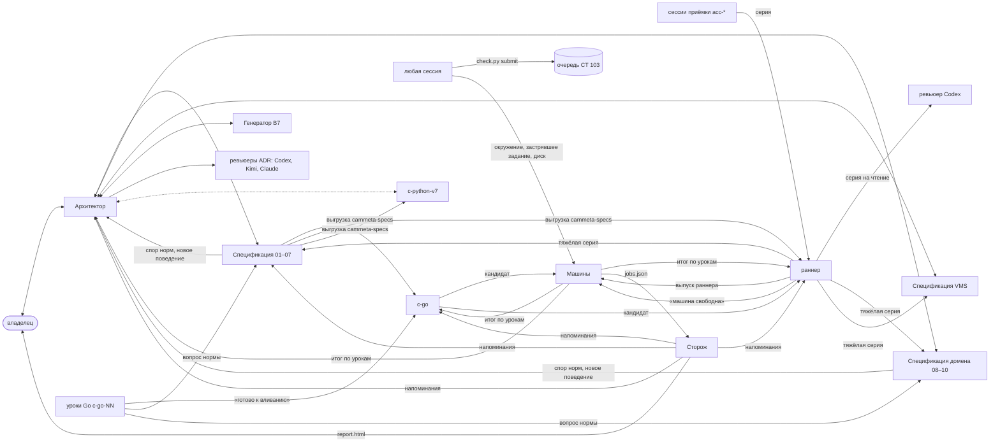

# Взаимодействие сессий

Кто с кем говорит, о чём и в каком порядке. Ведёт «Архитектор». Это описание того, как устроено сейчас, а не
новое решение. Решения записаны в ADR-0083 доп. (42), (48), (51), (54)–(59) с правками, ADR-0080, ADR-0090. Если
здесь что-то расходится с ADR, прав ADR. Состав и владение — `СЕССИИ.md` §2, машины и доступы — `ИНФРАСТРУКТУРА.md`,
запуск окон — `tools/sessions/README.md`.

## 1. Действующие сессии

Адрес окна каждой сессии записан в реестре `/Users/murat/w2c/cammeta-status/sessions.tsv`
(`tools/sessions/registry.sh get <имя>`). Адрес меняется при каждом перезапуске окна, поэтому по памяти его не берут.

| Имя в реестре | Сессия | Модель | Что делает |
|---|---|---|---|
| `architect` | «Архитектор» | Claude | решения и ADR, `СЕССИИ.md`, навыки `skills/`, вливание веток VMS, Генератора и ревьюеров, выгрузка после своих вливаний, разбор ревью, связь с владельцем |
| `spec` | «Спецификация» | Claude | нормы и приёмка уроков 01–07, `Platform/common/**`; отвечает на вопросы норм; выгрузка `cammeta-specs` |
| `spec-domain` | «Спецификация домена» | Claude | нормы и приёмка уроков 08–10; отвечает на вопросы норм этих уроков |
| `spec-vms` | «Спецификация VMS» | Claude | модуль `VMS/`; работает на ветках `vms/<тема>`, в main вливает «Архитектор» |
| `generator-v7` | «Генератор В7» | Claude | пакет `skills/lesson-spec/scripts/v7/`; в main кладёт «Архитектор» |
| `c-go` | ведущая линии Go | Claude | общие пакеты `common/*`, вливание уроков в линию, кандидаты |
| `c-go-exec` | исполнитель ведущей | Codex + исполнитель MiniMax | работа по задачам `c-go`: код генерирует MiniMax, Codex ставит задачу, ревьюит и проверяет |
| `c-go-01` … `c-go-10` | сессии уроков Go | Codex + исполнитель MiniMax | урок на ветке `lesson/NN`: прочтение норм, генерация, ревью, проверки, коммит |
| `c-python-v7` | ведущая линии Python В7 | Claude + MiniMax | библиотека готова; уроки начнутся после Go GREEN 01–10 на В7 |
| `runner` | раннер приёмки | Claude | только код раннеров: движки, судейство, описи, планы, драйвер, серии, выпуски раннера, перепины; разбор красных на дефект раннера (доп. (59)) |
| `acc-vectors`, `acc-stand-0102`, `acc-stand-0106`, `acc-stand-domain` | сессии приёмки | Codex | серии раннера по своей группе целей; задачи и отчёты — раннеру |
| `machines` | «Машины» | Claude | всё про сервер: CT 102 и CT 103 (снимки, откаты, E-ядра, пакеты), очередь проверок и пересыльщик, окна ноутбука, квалификация, запуск и ведение зачётных прогонов, повторы, итоги; диск; сводка `jobs.json`; токен и SSH-ключ (доп. (59)) |
| `watch` | «Сторож» | Claude Sonnet | раз в 5 минут обходит окна, напоминает тем, кого ждут, ведёт отчёт владельцу |
| `review-codex` | ревьюер Codex | Codex | читатель серий раннера; ревью ADR |
| `review-kimi` | ревьюер Kimi | Kimi | ревью ADR и спецификаций; серии раннера не читает (медленный) |
| `review-claude` | ревьюер Claude | Claude | ревью ADR; проверка прочтения нормы |
| `pilot` | пилот assist | Claude | харнес передан «Спецификации VMS»; новые замеры — по слову владельца |
| `fuzz` | дифф-проверка В7 | Codex | на паузе (владелец) |

## 2. Схема

## 3. Кто кому пишет

| Что | От кого | Кому |
|---|---|---|
| вопрос нормы уроков 01–07 и `Platform/common/**` | уроки Go, c-go, раннер, c-python-v7 | «Спецификация»: отвечает фразой в main и строкой журнала догадок, «Архитектору» — копию |
| вопрос нормы уроков 08–10 | те же | «Спецификация домена» — так же |
| вопрос по VMS | раннер, сессии приёмки | «Спецификация VMS» |
| новое поведение, спор двух норм, правка ADR | «Спецификации» | «Архитектор»: решает сам или несёт владельцу |
| урок готов к вливанию | сессия урока Go | c-go |
| кандидат на прогон | c-go | «Машины» и раннер, напрямую (не через «Архитектора»); раннер называет выпуск раннера |
| итог прогона по урокам | «Машины» | c-go, «Архитектор», раннер; раннер — какие красные дефект раннера |
| серия раннера | сессии приёмки | раннер; раннер отдаёт её читателям |
| чтение серии | раннер | лёгкая — ревьюер Codex; тяжёлая (исход, выборка, драйвер, судейство) — Codex и «Спецификация» её области |
| ветка VMS, Генератора, ревьюера готова | автор ветки | «Архитектор»: вливает, выгружает, сообщает автору и раннеру |
| правка спецификации внесена | «Спецификация», «Спецификация домена» | выгружает «Спецификация»; номер выгрузки — c-go и раннеру; «Архитектору» — копию |
| проверка на CT 103 | любая сессия | сама в очередь: `check.py submit … --who <сессия>`, затем `wait <id>`; посредника нет |
| нужен пакет или окружение на CT, задание очереди застряло или не исполняется, кончается место | любая сессия | «Машины», напрямую одной строкой (не раннеру) |
| правка `ИНФРАСТРУКТУРА.md` | «Машины» | «Архитектор» (текстом) |
| напоминание «тебя ждут», простой | «Сторож» | адресат ожидания и «Архитектор» |
| решение владельца, удаление данных, секреты | любая сессия | «Архитектор» → владелец |

Сообщение — одна строка в окно адресата:
`orca terminal send --terminal <handle> --text "<кто> → <кому>: …" --enter`. Отчёт начинается с имени отправителя.
Если отправить не удалось, строку пишут в своём окне и повторяют отправку.

## 4. Порядок работы

### 4.1 Урок Go → кандидат → прогон
1. Сессия урока Go читает нормы своего урока в выгрузке. Двоякие места она до генерации относит в «Спецификацию»
   своих уроков, а догадки по правилам доп. (53) п. 3 решает сама и записывает в `GUESSES.md`.
2. Генерирует исполнитель MiniMax, сессия урока делает ревью. Проверки дольше 2 минут идут в очередь CT 103
   (`check.py submit` / `wait`). Когда всё готово — «готово к вливанию» в окно c-go.
3. c-go вливает уроки в линию, собирает кандидата на текущей выгрузке и объявляет его «Машинам» и раннеру.
4. Раннер называет выпуск раннера для прогона. «Машины» стартуют объявленный зачётный прогон сразу, раньше всего
   прочего: квалификация, откат CT 102 к базе снимков, драйвер из выпуска. Итог по урокам «Машины» отправляют c-go,
   «Архитектору» и раннеру; повторы по правилам и пин-варианты ведут они же.
5. Красная цель уходит в разбор: раннер говорит, дефект ли это раннера (тогда — серия раннера); дефект реализации —
   уроку через c-go; дефект нормы — «Спецификации».

До перехода по доп. (59) — после `C592L` — прогоны ещё ведёт раннер.

### 4.2 Серия раннера
Сессия приёмки делает серию в своём дереве и отдаёт её раннеру. Раннер отправляет серию читателям (§3) и вливает её в
свой main, когда все читатели дали CLEAN. Находки читателей раннер разбирает сам и не ждёт Kimi.

### 4.3 Спецификация и выгрузка
«Спецификация» и «Спецификация домена» правят нормы и данные в main курса. Выгружает «Спецификация» (`tools/export.sh`
в `/Users/murat/w2c/cammeta-specs`), «Архитектор» — после своих вливаний. Номер выгрузки получают c-go и раннер: на ней
собирается следующий кандидат и на неё перепинивается раннер. Перед коммитом выгрузки — поиск утечек путей.

### 4.4 VMS
«Спецификация VMS» работает на ветке `vms/<тема>`, проверяет `check_spec` на CT 103 и пишет «Архитектору» «ГОТОВО к
вливанию». «Архитектор» проверяет границу (`tools/vms-boundary/check.py`), вливает, выгружает и сообщает ей и раннеру.
Раннер прогоняет стенд jsdom на новом пине.

### 4.5 Решения и ADR
Решение владельца записывает файлом в `decisions/` та сессия, которая его услышала; обычно это «Архитектор». Новый ADR
идёт на ревью трём ревьюерам (Codex, Kimi, Claude). «Архитектор» разбирает отчёты, пишет разбор во
`decisions/inbox/` и вносит нормы. Догадки стадии C записываются в журнал `decisions/inbox/2026-10-23-догадки-стадии-C.md`:
решение «Спецификации» — её строкой, решение «Архитектора» — его строкой.

### 4.6 Машины и очередь
- Зачётные прогоны идут на CT 102, удалённые проверки — на CT 103 (`check.py submit … / wait <id>`), короткие
  проверки — на ноутбуке.
- Пока идёт окно приёмки на ноутбуке («Машины» объявляют OPEN … CLOSED), лёгкие проверки идут только через
  `light_check.py`, а тяжёлое на ноутбуке не запускают.
- Машины, очередь, окна и прогоны ведут только «Машины» (доп. (59)); зачётный прогон у них идёт первым, обслуживание
  машин — между прогонами. Токен Proxmox и SSH-ключ к CT — только у них.

## 5. Статус и простои

- **Строка остановки.** Ход, после которого сессии нечего делать, кончается последней строкой в окне:
  `СТОП: <почему> | ЖДУ: <чего> от <кого/события>`. Файла статуса нет: «Сторож» читает окна сам. Строка СТОП на экране
  значит, что сессия стоит, а если строки на экране нет, сессия работает.
- **«ЖДУ» — это и сообщение.** Если сессия ждёт другую сессию, она сразу шлёт ей одну строку в окно. Если ждёт события
  (выгрузки, прогона, условия), пишет его как событие, а не как сессию.
- **План закрыт — не ждать.** Ведущая с подчинёнными сессиями объявляет следующий этап до того, как кончился текущий.
  Сессия с закрытым планом берёт постоянные дела своего шаблона.
- **«Сторож»** раз в 5 минут:
  - напоминает адресату, если сессия ждёт конкретного ответа больше 15 минут. Одно напоминание на остановку, повтор —
    через час. «Ждёт поручений» — это «свободна», напоминания нет;
  - ищет простои: машина свободна, а задание ждёт; объявленный прогон не начат за 15 минут. Выясняет причину и пишет
    исполнителю и «Архитектору»;
  - ведёт отчёт владельцу `file:///Users/murat/w2c/cammeta-watch/report.html`: сессии, кто кого ждёт, простои, задания
    из сводки «Машин» (`/Users/murat/w2c/cammeta-status/jobs.json`), очередь, диск.

## 6. Что решает кто

| Вопрос | Решает |
|---|---|
| смысл нормы, если ответ уже есть в нормах, векторах или журнале | «Спецификация» своих уроков |
| догадка реализации по правилам доп. (53) п. 3 | сессия урока сама, запись в `GUESSES.md` |
| новое поведение, спор норм, перечень слов диалекта, вливание в main | «Архитектор» |
| принципы, состав сессий, удаление данных, секреты и доступы, деньги и квоты | владелец (через «Архитектора») |

## 7. Общие правила

- Git — по файлам, без `add -A`, `--amend`, `stash`. Worktree удаляют только после успешного push.
- Секреты не печатают и не пишут в файлы и сообщения. Где лежат секреты и кто ими пользуется — `ИНФРАСТРУКТУРА.md`
  «Доступы».
- Продукт и `Source/vms/*` заморожены.
- Codex запускается без песочницы: `-s danger-full-access -a never`. Перезапуск — только в простое окна
  (`tools/sessions/README.md`).
