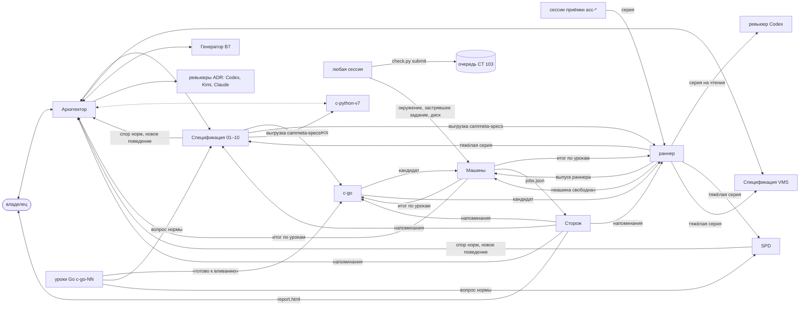

# Взаимодействие сессий

Кто с кем говорит, о чём и в каком порядке. Ведёт «Архитектор». Это описание того, как устроено сейчас, а не
новое решение. Решения записаны в ADR-0083 доп. (42), (48), (51), (54)–(59) с правками, ADR-0080, ADR-0090. Если
здесь что-то расходится с ADR, прав ADR. Состав и владение — `СЕССИИ.md` §2, машины и доступы — `ИНФРАСТРУКТУРА.md`,
запуск окон — `tools/sessions/README.md`.

## 1. Сессии (история; действующий состав — §1a и `СЕССИИ.md` §2.0)

Адрес окна каждой сессии записан в реестре `cammeta-sessions/sessions.tsv` (§1a; прежний путь `/Users/murat/w2c/cammeta-status/sessions.tsv` — ссылка)
(`tools/sessions/registry.sh get <имя>`). Адрес меняется при каждом перезапуске окна, поэтому по памяти его не берут.

| Имя в реестре | Сессия | Модель | Что делает |
|---|---|---|---|
| `architect` | «Архитектор» | Claude | решения и ADR, `СЕССИИ.md`, навыки `skills/`, вливание веток VMS, Генератора и ревьюеров, выгрузка после своих вливаний, разбор ревью, связь с владельцем |
| `spec` | «Спецификация» | Claude | нормы и приёмка уроков 01–07, `Platform/common/**`; отвечает на вопросы норм; выгрузка `cammeta-specs` |
| `spec-domain` | «Спецификация домена» — свёрнута 2026-10-30, уроки 08–10 у «Спецификации» | — | — |
| `spec-vms` | «Спецификация VMS» | Claude | модуль `VMS/`; работает на ветках `vms/<тема>`, в main вливает «Архитектор» |
| `generator-v7` | «Генератор В7» | Claude | пакет `skills/lesson-spec/scripts/v7/`; в main кладёт «Архитектор» |
| `c-go` | ведущая линии Go | Claude | общие пакеты `common/*`, вливание уроков в линию, кандидаты |
| `c-go-exec` | исполнитель ведущей | Codex + исполнитель MiniMax | работа по задачам `c-go`: код генерирует MiniMax, Codex ставит задачу, ревьюит и проверяет |
| `c-go-01` … `c-go-10` | сессии уроков Go | Codex + исполнитель MiniMax | урок на ветке `lesson/NN`: прочтение норм, генерация, ревью, проверки, коммит |
| `c-python-v7` | ведущая линии Python В7 | Claude + MiniMax | библиотека готова; уроки начнутся после Go GREEN 01–10 на В7 |
| `runner` | раннер приёмки | Claude | только код раннеров: движки, судейство, описи, планы, драйвер, серии, выпуски раннера, перепины; разбор красных на дефект раннера (доп. (59)) |
| `acc-vectors`, `acc-stand-0102`, `acc-stand-0106`, `acc-stand-domain` | сессии приёмки | Codex | серии раннера по своей группе целей; задачи и отчёты — раннеру |
| `machines` | «Машины» | Claude | всё про сервер: CT 102 и CT 103 (снимки, откаты, E-ядра, пакеты), очередь проверок и пересыльщик, окна ноутбука, квалификация, запуск и ведение зачётных прогонов, повторы, итоги; диск; сводка `jobs.json`; токен и SSH-ключ (доп. (59)) |
| `watch` | «Сторож» | Claude Sonnet | раз в 5 минут обходит окна, напоминает тем, кого ждут, ведёт отчёт владельцу |
| `review-codex` | ревьюер Codex | Codex | читатель серий раннера; ревью ADR и норм, модель Quint агентом (ADR-0114 доп. (6)–(10)) |
| `review-kimi` | ревьюер Kimi | Kimi | ревью ADR и спецификаций; серии раннера не читает (медленный) |
| `review-claude` | ревьюер Claude | Claude | ревью ADR и норм, модель Quint агентом (ADR-0114 доп. (6)–(9)); проверка прочтения нормы |
| `pilot` | пилот assist | Claude | харнес передан «Спецификации VMS»; новые замеры — по слову владельца |
| `fuzz` | дифф-проверка В7 | Codex | на паузе (владелец) |

## 1a. CT 103 — автономная часть (с 2026-11-06, З-12 от 2026-11-07)

Работа CT 103 не зависит от мака. Действуют ADR-0083 (118)–(139); таблица §1 выше — история, при расхождении верен этот раздел.

**Маршруты от 2026-11-08 действуют** (слияние d4d758d56, доп. (142)). Диспетчер — `dispatcher103`; всеобщая пауза снята словом владельца. Передача функций Сторожа — план, условия ниже.

**Реестр.** `/home/pilot/cammeta-sessions/sessions.tsv`, на маке тот же общий репозиторий. CT103↔CT103: `orca terminal send --terminal <handle> --text '…' --enter`. С мака — `--environment ct103`, к маку — `--environment mac`. После З-11 телефон спаривается с сервером CT103 напрямую, ссылка только в защищённом игнорируемом файле owner/mobile-pairing.txt; не в сообщениях.

| Сессия | Модель | Поток |
|---|---|---|
| architect | Claude | слово владельца → ADR, споры и разбор ревью норм, границы/договоры уроков, новые классы; решения ответственным, Диспетчеру — для учёта |
| dispatcher103 | Codex (окно прежнего Архитектора); дешёвую модель low–medium назовёт владелец | приём З-N и маршрутизация, поручения/квитанции/закрытие запросов, план/Гант/паузы; обход CT-окон, СТОП/ЖДУ/простои/напоминания, локальная сборка данных отчёта и файловый adr-refresh; без root и управления службами |
| coord103-src | Codex | spec103/spec103-claude, ревью уроков и раннер; frozen SOURCE, нормы/формы и их проверки, договор профиля З-16, задачи/чтения серий; задания проб MiniMax, пины раннера, выгрузка `cammeta-specs` и подготовка нового пина (выбор — владелец); учётный итог Диспетчеру, смысловые вопросы/готовые ревью Архитектору |
| coord103-tools | Codex | Генераторы и пакеты уроков, судьи форм, код инструментальных проверок; tools/** и делегированные skills/**, инструментальные срезы, одна полная проверка `check_spec`; итог Диспетчеру, новый смысл/класс Архитектору, root-задачи ops103 |
| spec103 | Codex | источник Platform, один писатель урока; сейчас также остаток P09 после сохранённой точки Claude |
| review103 | Codex | ревью уроков через src; код судей через tools; решения по находкам у Архитектора |
| review103-kimi | Kimi | независимые ревью уроков через src, отчёт Архитектору |
| review103-claude | Claude | исключён до подтверждённого сброса, позднее независимое дополнение не блокирует нынешний P10 |
| spec103-claude | Claude | исключён до подтверждённого сброса; затем новая актуальная передача src, не автоматический возврат в P09 |
| generators | Codex | действующая единственная сессия Генераторов, поток tools |
| runner | Codex | раннер, поток src; договор профиля со spec103, задачи и чтения серий от src |
| ops103 | Codex (`admin103`) | отдельная root-роль: выпуски, судья MiniMax, здоровье/диск/службы/таймеры/права/порты; страница отчёта целиком: код `cammeta-watch.git` (шаблон, сборщик, сервер) правит как пользователь pilot через git, коммит на каждую правку; root — только служба (cammeta-report, таймер сборщика, порт, права, перезапуск); прямая доставка CT103↔мак; заявки на снимки и ресурсы строкой на мак; CT-часть pilot-sync/check-forwarder/check-router по условиям ниже; результат назначенному принимающему, учётный итог Диспетчеру |
| pilot | Claude | служба ассистента; инфраструктура и доставка — ops103, учёт — Диспетчер |
| Сторож (`watch`, мак) | Claude | только окна мака и маковые launchd orca-sync/caffeinate/mem-watch/jobs/inputs-clean; снимки и ресурсы CT103 нынешним токеном по строке ops103 (либо представитель владельца); аварийный Proxmox при падении CT103 и запасной root-ключ мака — по слову владельца |

**Кто кому пишет.** Логическое назначение поручения отделено от технической доставки: Диспетчер выбирает ответственного и ведёт учёт, ops103 обслуживает канал, ошибки отправки и недоступные адреса. Доставка CT103↔мак прямая через Orca: к маку `--environment mac`, с мака `--environment ct103`, без ретранслятора-Сторожа. Длительная root-работа не ставится в очередь Диспетчера; Диспетчер и ops103 — разные сессии, Диспетчер не получает root.

| Что | Кто отправляет | Кому и что дальше |
|---|---|---|
| Новый З-N, уточнение, отмена или пауза | владелец / его представитель | Диспетчеру: дословная запись, один ответственный и условия результата; слово владельца с новым решением сразу Архитектору для ADR |
| Поручение по действующему решению | Диспетчер | src — нормы/формы/ревью уроков/раннер/задания проб/пины раннера/export; tools — генераторы/пакеты уроков/судьи/инструментальные проверки; ops103 — инфраструктура и доставка; spec103/review103 — только в согласованном потоке src/tools, без дублирующей постановки |
| Техническая доставка, отказ канала или служебное уведомление о здоровье/диске/службе | отправитель / монитор / Сторож | ops103: техническая работа в точной разрешённой области; Диспетчеру только итог, блокер и влияние на план |
| Готовая доля, новые доказательства | исполнитель | единственному принимающему src/tools либо заранее назначенному принимающему root-задачи; Диспетчер получает его квитанцию, выводы и пределы |
| Изменение остатка, зависимости или фактического статуса | ответственный координатор; spec103/review103 при прямом поручении | Диспетчеру: фактический старт/итог, свежая собственная оценка и условия; без повторной копии доказательств |
| Новый смысл, спор норм/границ/владения, готовый пакет разбора ревью | src/tools или ответственный за вопрос | Архитектору: точный вопрос с рекомендацией либо законченный смысловой пакет; Диспетчеру — только зависимость и состояние решения |
| Принятое решение, изменение договора | Архитектор | ответственному исполнителю через его координатора; Диспетчеру решение и пределы для учёта, без ожидания дополнительного ACK |
| Вопрос владельцу В-N | тот, чьё это решение, обычно Архитектор | сам формулирует вопрос, варианты и рекомендацию; Диспетчер дословно записывает в owner-journal.md, не выбирая и не меняя смысл |
| Ответ владельца на В-N | владелец / его представитель | Диспетчер записывает дословно и сообщает адресату вопроса; решение и необходимые действия принадлежат ответственному |
| Окна CT103, СТОП/ЖДУ, простои | локальный обход Диспетчера | адресатам — напоминания с учётом paused.tsv; результат — в CT-данные страницы, без обхода CT103 с мака |
| Окна мака | Сторож | отдельная маковая сводка Диспетчеру; маковые ожидания адресатам; CT-снимок Сторож не перезаписывает |
| «ADR обновлён» | автор изменения / Архитектор | Диспетчеру для файлового adr-refresh и производного отчёта; это не решение о повышении колонок конвейера |
| Плановый Proxmox: снимки, ресурсы, назначенная перезагрузка CT103 | ops103 строкой в окно | Сторожу или представителю владельца на маке: выполняют нынешним токеном; у CT103 доступа к Proxmox нет (В-34). Расширение диска — владелец |
| Аварийный Proxmox при падении CT103, применение запасного root-ключа мака | только владелец | Сторожу на маке; это отдельное поручение, не требует доступного Диспетчера/ops103 на упавшем CT103 |
| Итог З-N и закрытие запроса | Диспетчер | владельцу / в журнал по условиям поручения и квитанции ответственного; если нужно подтверждение владельца, запрос остаётся открытым до него |

Диспетчер ведёт в cammeta-sessions `watch/requests.tsv`, фактический `owner-journal.md`, `plan-roadmap.md` и `paused.tsv`. Вопрос В-N ставит ответственный за решение; Диспетчер только записывает вопрос и ответ владельца дословно и сообщает ответ адресату. План/Гант обновляются по свежим оценкам и зависимостям раз в час и при существенном изменении; Начало/Срок `YYYY-MM-DD UTC` не выводятся из неизвестного входа, неопределённость записывается явно. В `paused.tsv` переносят точное решение владельца; сброс лимита, готовность входа и новая роль сами работу не возобновляют. Здоровье, диск, службы, порты, таймеры и доставка принадлежат ops103; учёт этих результатов не передаёт Диспетчеру технические полномочия. Удаление, resize, restart или иное действие вне поручения требуют прежнего основания, владение областью его не заменяет.

**Передача CT-функций Сторожа.** Диспетчер локально обходит окна CT103, читает СТОП/ЖДУ и формирует напоминания/учёт простоев, не снимая паузы. Он собирает на CT103 `watch/last.json`, план/Гант/журнал/запросы/сообщения/открепления для страницы и `report.html`, если используется файловый снимок. Сторож сохраняет только маковую сводку. Код обхода, сборщика, шаблона CT-страницы и переноса adr-refresh и `cammeta-report.service` (8765), его права и среду ведёт ops103 (ADR-0083 доп. (143)); Диспетчер использует готовые средства. Кнопочные записи страницы сохраняются, единственный писатель снимка не подменяет авторство ответов владельца.

Файловый `adr-refresh.sh` переходит Диспетчеру после проверки состава: чтение Git/файлов курса и обновление производного отчёта допустимы; системные действия выделяют ops103, курсовые проверки — их ответственному src/tools. Решения review/nrev/quint и другие смысловые отметки остаются у Архитектора; сообщение «ADR обновлён» не повышает их автоматически.

**Уточнения к переносу; пока не исполнены.** Текущий CT-пакет при `CAMMETA_WATCH_PASS=0` читает снимок с мака и сам обход не запускает. Требуется перенести сборщик и подтвердить свежесть CT-данных без мака, затем прекратить маковую запись CT-снимка; для `watch/last.json` оставляют одного писателя. Синхронизация не должна вернуть старый маковый снимок поверх нового или потерять кнопочные записи. Сейчас не переключают режим страницы, службы, таймеры и писателей.

Токен на CT103 не выпускается (В-34, ADR-0132 п. 9): снимки, ресурсы и назначенную перезагрузку делают с мака нынешним токеном по строке ops103 в окно Сторожа или представителя владельца. Аварийный Proxmox при падении CT103 остаётся на маке у Сторожа, поручение даёт только владелец. Запасной root-ключ мака не переносится и применяется Сторожом только по отдельному слову владельца.

Ops103 получает CT-часть pilot-sync/check-forwarder/check-router: перенос нужного на таймеры CT103 либо снятие после подтверждения отсутствия потребителей и сохранности очереди. Закрытие очереди проверок 4–5 ноября пока не доказано; `pilot-sync` также нужен общим данным cammeta-sessions, поэтому снять его только по возрасту очереди нельзя. До переноса фиксируют все потребители и маковые зависимости; общий обмен с маком сохраняют, двойных запусков не вводят. Сторожу остаются только маковые launchd orca-sync/caffeinate/mem-watch/jobs/inputs-clean; существующие задания этой веткой не снимают и не переносят.

**Вливания.** Свои разрешённые файлы и нужные собственные успешные проверки — автор вливает сам, координатор не обязательный шлюз. Проверяется всё невлитое приращение относительно текущей основной ветки; чужие невлитые зависимости означают общий срез. Src передаёт tools точный SHA источника; tools сводит с инструментами и выполняет одну полную проверку на main. Компонентная приёмка не общая готовность. Все сессии, кроме владельца основного дерева, используют свои рабочие деревья с проверкой toplevel.

**Задача до результата; один принимающий (доп. (139)).** Src/tools выдают исполнителю законченную задачу с нужными правками, изолированной средой/зависимостями, целевыми проверками, исправлением дефектов и публикацией своей доли. Отдельных CODE/PREP/SYNTAX/RUN/freeze/intake-ACK у Архитектора нет. Принимающий один: src для своего потока, tools для своего; ops сдаёт root-результат координатору, который его поставил. Принимающий один раз проверяет полноту, происхождение и нужные байты/результат; дальше передаёт квитанцию и пределы. Архитектор и следующий получатель не копируют, не хешируют и не исполняют прежний архив повторно. Новые байты/значимая среда, расхождение, сомнительная квитанция или новая независимая смысловая цель дают явное основание повторить затронутую часть. Рутинный межпотоковый стык решают координаторы; новый смысл/класс/спор о владении — Архитектору. Прямые запреты владельца сохраняются.

Диспетчер не становится дополнительным принимающим или обязательным шлюзом: не повторяет аудит, не разрешает стадии и не держит продолжение задачи до обновления учёта. Нормы, формы и код проверок пишут исполнители src/tools; Архитектор оставляет себе смысловые решения, а правки `skills/**` делегирует явно на целую задачу. Подготовка, выполненная проверка, компонентная готовность и общая готовность в учёте различаются. Требуемые независимые ревью сохраняются; неизменяемые задания отделены от текущего учёта, чужие выводы рецензентам до обеих сдач не пересылаются.

**Независимость.** Один точный срез и собственный отчёт каждого рецензента, без обмена находками до сдачи, проверка З-10. До сброса обеих Claude обязательных рецензентов два: review103/Kimi; P10 разбирается по двум готовым отчётам. Один условный таймер у tools, первая проверка8Nov06:05UTC после свежего подтверждения сброса/лимита. Поздний Claude отдельно. Один урок — один писатель, общие блоки до правок согласует src.

**Остальные маршруты.** Работа на CT 103 — только по Platform (ADR-0083 доп. (146)): VMS, spec-vms, приём её долей и VMS-ревью ведёт представитель владельца на маке; сессии CT 103 VMS не берут. Маковая spec и generators-2 закрыты, их сохранённые передачи не теряются. Прежнее закрытие ops103 отменено З-17: отдельная root-сессия возвращается; существующая передача и доказательства сохраняются. Общий журнал и данные страницы ведёт Диспетчер на CT103, службу страницы и прямую доставку без макового ретранслятора — ops103. Вопросы с вариантами — в «Открытые вопросы», отчёты сверху — в «Отчёты»; вопрос В-N ставит ответственный, запись вопроса и ответа дословная. Окно owner только для срочного. Сторож больше не обслуживает CT-поток, кроме аварийного восстановления по прямому слову владельца. Изменение маршрутов не снимает прямые ограничения VMS, моделей и Owner-only проб.

## 2. Схема

## 3. Кто кому пишет

| Что | От кого | Кому |
|---|---|---|
| вопрос нормы уроков 01–10 и `Platform/common/**` | уроки Go, c-go, раннер, c-python-v7 | «Спецификация»: отвечает фразой в main и строкой журнала догадок, «Архитектору» — копию |
| вопрос по VMS | раннер, сессии приёмки | «Спецификация VMS» |
| новое поведение, спор двух норм, правка ADR | «Спецификации» | «Архитектор»: решает сам или несёт владельцу |
| урок готов к вливанию | сессия урока Go | c-go |
| кандидат на прогон | c-go | «Машины» и раннер, напрямую (не через «Архитектора»); раннер называет выпуск раннера |
| итог прогона по урокам | «Машины» | c-go, «Архитектор», раннер; раннер — какие красные дефект раннера |
| серия раннера | сессии приёмки | раннер; раннер отдаёт её читателям |
| чтение серии | раннер | лёгкая — ревьюер Codex; тяжёлая (исход, выборка, драйвер, судейство) — Codex и «Спецификация» её области |
| ветка VMS, Генератора, ревьюера готова | автор ветки | «Архитектор»: вливает, выгружает, сообщает автору и раннеру |
| правка спецификации внесена | «Спецификация» | выгружает «Спецификация»; номер выгрузки — c-go и раннеру; «Архитектору» — копию |
| проверка на CT 103 | любая сессия | сама в очередь: `check.py submit … --who <сессия>`, затем `wait <id>`; посредника нет |
| нужен пакет или окружение на CT, задание очереди застряло или не исполняется, кончается место | любая сессия | «Машины», напрямую одной строкой (не раннеру) |
| правка `ИНФРАСТРУКТУРА.md` | «Машины» | «Архитектор» (текстом) |
| напоминание «тебя ждут», простой | «Сторож» | адресат ожидания и «Архитектор» |
| решение владельца, удаление данных, секреты | любая сессия | «Архитектор» → владелец |

Сообщение — одна строка в окно адресата:
`orca terminal send --terminal <handle> --text "<кто> → <кому>: …" --enter`. Отчёт начинается с имени отправителя.
Если отправить не удалось, строку пишут в своём окне и повторяют отправку.

## 4. Порядок работы

### 4.1 Урок Go → кандидат → прогон
1. Сессия урока Go читает нормы своего урока в выгрузке. Двоякие места она до генерации относит в «Спецификацию»
   своих уроков, а догадки по правилам доп. (53) п. 3 решает сама и записывает в `GUESSES.md`.
2. Генерирует исполнитель MiniMax, сессия урока делает ревью. Проверки дольше 2 минут идут в очередь CT 103
   (`check.py submit` / `wait`). Когда всё готово — «готово к вливанию» в окно c-go.
3. c-go вливает уроки в линию, собирает кандидата на текущей выгрузке и объявляет его «Машинам» и раннеру.
4. Раннер называет выпуск раннера для прогона. «Машины» стартуют объявленный зачётный прогон сразу, раньше всего
   прочего: квалификация, откат CT 102 к базе снимков, драйвер из выпуска. Итог по урокам «Машины» отправляют c-go,
   «Архитектору» и раннеру; повторы по правилам и пин-варианты ведут они же.
5. Красная цель уходит в разбор: раннер говорит, дефект ли это раннера (тогда — серия раннера); дефект реализации —
   уроку через c-go; дефект нормы — «Спецификации».

До перехода по доп. (59) — после `C592L` — прогоны ещё ведёт раннер.

### 4.2 Серия раннера
Сессия приёмки делает серию в своём дереве и отдаёт её раннеру. Раннер отправляет серию читателям (§3) и вливает её в
свой main, когда все читатели дали CLEAN. Находки читателей раннер разбирает сам и не ждёт Kimi.

### 4.3 Спецификация и выгрузка
«Спецификация» правит нормы и данные в main курса (уроки 08–10 — с 2026-10-30). Выгружает «Спецификация» (`tools/export.sh`
в `/Users/murat/w2c/cammeta-specs`), «Архитектор» — после своих вливаний. Номер выгрузки получают c-go и раннер: на ней
собирается следующий кандидат и на неё перепинивается раннер. Перед коммитом выгрузки — поиск утечек путей.

### 4.4 VMS
«Спецификация VMS» работает на ветке `vms/<тема>`, проверяет `check_spec` на CT 103 и пишет «Архитектору» «ГОТОВО к
вливанию». «Архитектор» проверяет границу (`tools/vms-boundary/check.py`), вливает, выгружает и сообщает ей и раннеру.
Раннер прогоняет стенд jsdom на новом пине.

### 4.5 Решения и ADR
Решение владельца записывает файлом в `decisions/` та сессия, которая его услышала; обычно это «Архитектор». Новый ADR
идёт на ревью `review-claude` и `review-codex`; ревью норм — ими же, модель Quint — агентом в сессии ревьювера (ADR-0114 доп. (6), (7)). Порядок — ADR-0114, ПРАВИЛА-РАБОТЫ §4: «Архитектор» разбирает отчёт и двигает `review_to` в `decisions/adr-pipeline.tsv`, нормы сессии берут из таблицы сами, письма не ждут. Догадки стадии C записываются в журнал `decisions/inbox/2026-10-23-догадки-стадии-C.md`:
решение «Спецификации» — её строкой, решение «Архитектора» — его строкой.

### 4.6 Машины и очередь
- Зачётные прогоны идут на CT 102, удалённые проверки — на CT 103 (`check.py submit … / wait <id>`), короткие
  проверки — на ноутбуке.
- Пока идёт окно приёмки на ноутбуке («Машины» объявляют OPEN … CLOSED), лёгкие проверки идут только через
  `light_check.py`, а тяжёлое на ноутбуке не запускают.
- Машины, очередь, окна и прогоны ведут только «Машины» (доп. (59)); зачётный прогон у них идёт первым, обслуживание
  машин — между прогонами. Токен Proxmox и SSH-ключ к CT — только у них.

## 5. Статус и простои

- **Строка остановки.** Ход, после которого сессии нечего делать, кончается последней строкой в окне:
  `СТОП: <почему> | ЖДУ: <чего> от <кого/события>`. Файла статуса нет: «Сторож» читает окна сам. Строка СТОП на экране
  значит, что сессия стоит, а если строки на экране нет, сессия работает.
- **«ЖДУ» — это и сообщение.** Если сессия ждёт другую сессию, она сразу шлёт ей одну строку в окно. Если ждёт события
  (выгрузки, прогона, условия), пишет его как событие, а не как сессию.
- **План закрыт — не ждать.** Ведущая с подчинёнными сессиями объявляет следующий этап до того, как кончился текущий.
  Сессия с закрытым планом берёт постоянные дела своего шаблона.
- **«Сторож»** раз в 5 минут:
  - напоминает адресату, если сессия ждёт конкретного ответа больше 15 минут. Одно напоминание на остановку, повтор —
    через час. «Ждёт поручений» — это «свободна», напоминания нет;
  - ищет простои: машина свободна, а задание ждёт; объявленный прогон не начат за 15 минут. Выясняет причину и пишет
    исполнителю и «Архитектору»;
  - ведёт отчёт владельцу `file:///Users/murat/w2c/cammeta-watch/report.html`: сессии, кто кого ждёт, простои, задания
    из сводки «Машин» (`/Users/murat/w2c/cammeta-status/jobs.json`), очередь, диск.

## 6. Что решает кто

| Вопрос | Решает |
|---|---|
| смысл нормы, если ответ уже есть в нормах, векторах или журнале | «Спецификация» своих уроков |
| догадка реализации по правилам доп. (53) п. 3 | сессия урока сама, запись в `GUESSES.md` |
| новое поведение, спор норм, перечень слов диалекта, вливание в main | «Архитектор» |
| принципы, состав сессий, удаление данных, секреты и доступы, деньги и квоты | владелец (через «Архитектора») |

## 7. Общие правила

- Git — по файлам, без `add -A`, `--amend`, `stash`. Worktree удаляют только после успешного push.
- Секреты не печатают и не пишут в файлы и сообщения. Где лежат секреты и кто ими пользуется — `ИНФРАСТРУКТУРА.md`
  «Доступы».
- Продукт и `Source/vms/*` заморожены.
- Codex запускается без песочницы: `-s danger-full-access -a never`. Перезапуск — только в простое окна
  (`tools/sessions/README.md`).
